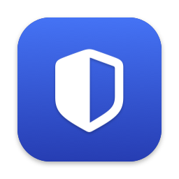
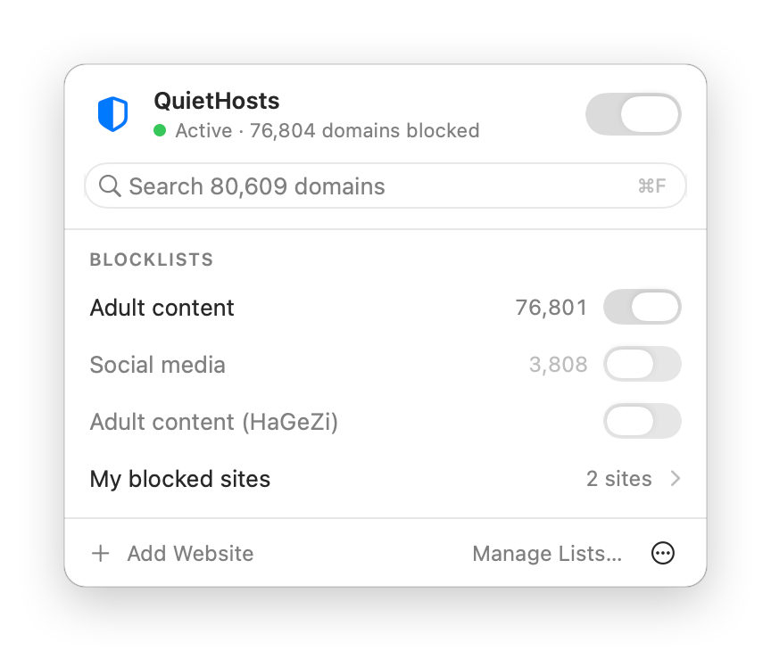
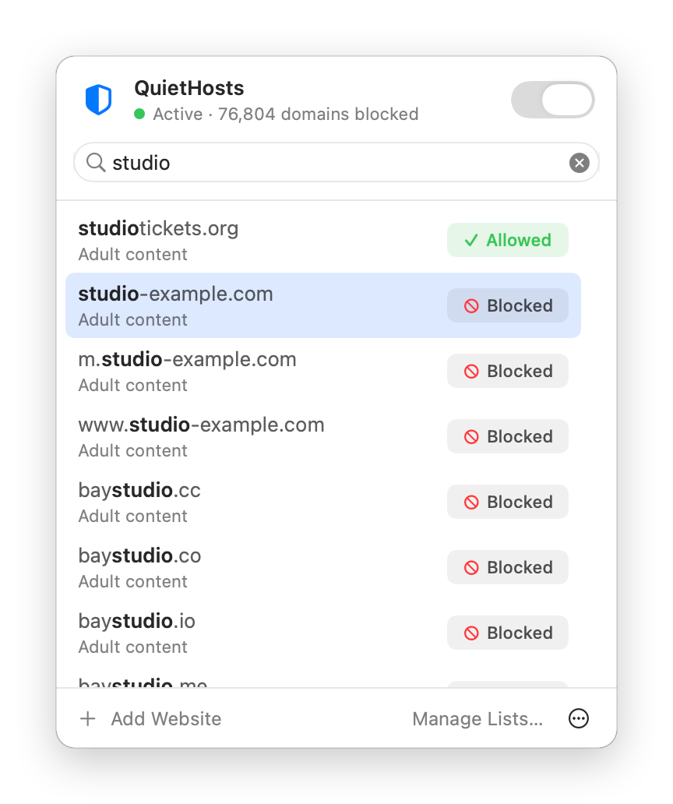
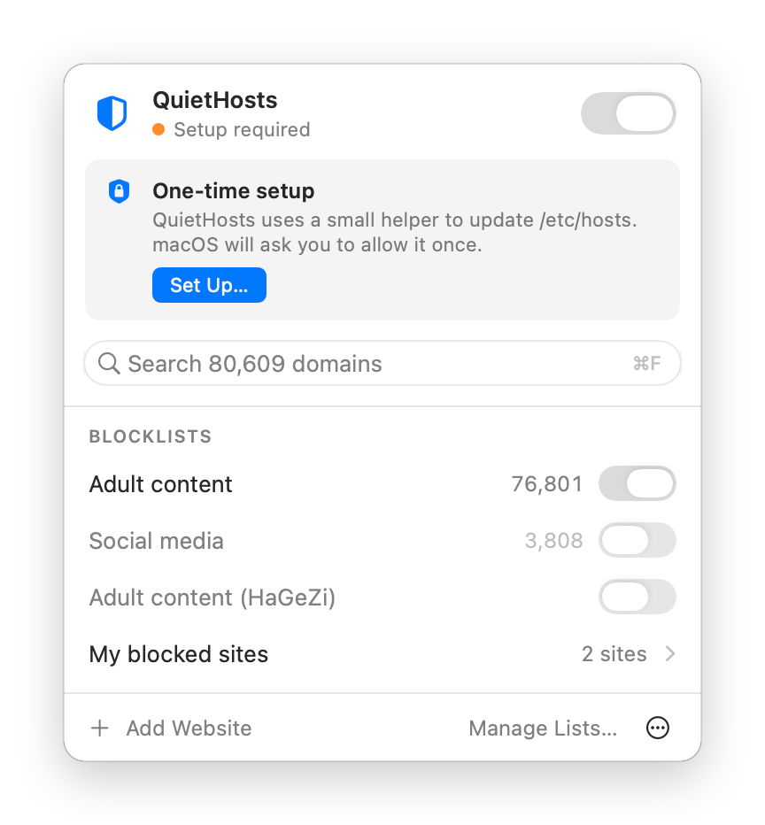
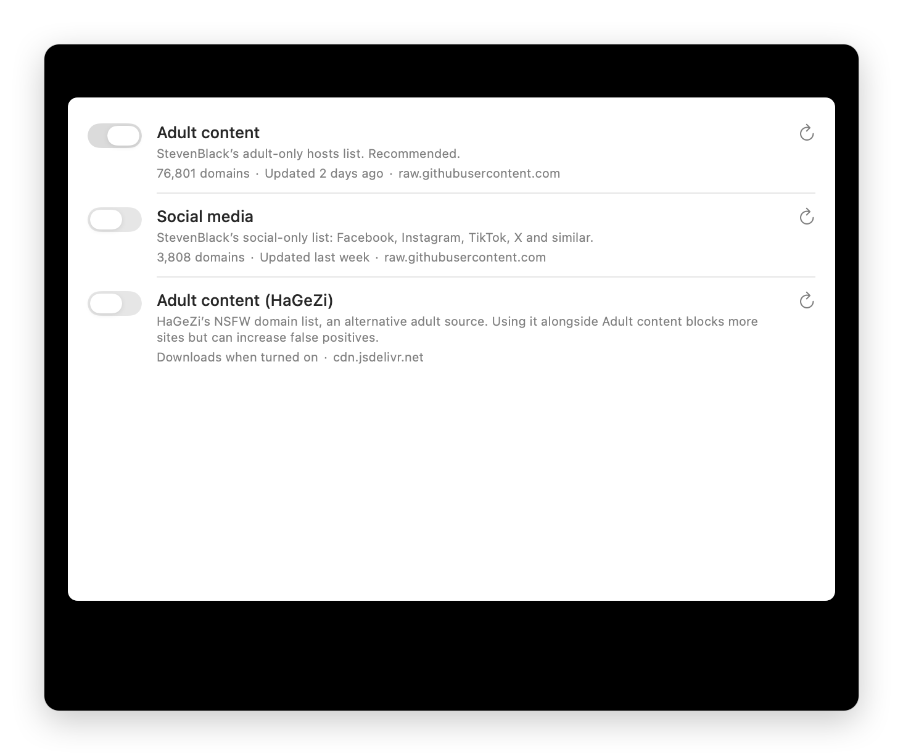

<p align="center">
  
</p>

<h1 align="center">QuietHosts</h1>

<p align="center">
  A tiny, private Mac menu-bar app that blocks websites across your whole Mac,<br>
  with instant search and one-click exceptions.
</p>

<p align="center">
  <a href="https://github.com/ruairidhflint/QuietHosts/actions/workflows/ci.yml"></a>
  
  
  
  
  <a href="LICENSE"></a>
</p>

<p align="center">
  <picture>
    <source media="(prefers-color-scheme: dark)" srcset="docs/images/popover-dark.png">
    
  </picture>
  <picture>
    <source media="(prefers-color-scheme: dark)" srcset="docs/images/search-dark.png">
    
  </picture>
</p>

## Features

- **Blocks everywhere.** Every browser, private and incognito windows included. No extensions, no DNS changes.
- **Instant search.** Find any of 75,000+ blocked domains as you type, and allow or re-block it with one click.
- **Exceptions that stick.** Sites you allow stay allowed when lists update.
- **Curated lists.** [StevenBlack](https://github.com/StevenBlack/hosts) adult content (on by default) and social media, [HaGeZi](https://github.com/hagezi/dns-blocklists) NSFW, plus any list of your own from a URL or file.
- **Careful with your system.** QuietHosts edits only its own marked section of `/etc/hosts`, backs the file up, writes atomically and checks the result.
- **Private.** No account, no telemetry, nothing leaves your Mac except list downloads.
- **Stays on.** Blocking keeps working after you quit the app or restart your Mac.

## Install

**You need:** a Mac with Apple Silicon running macOS 14 Sonoma or later, and [Xcode](https://apps.apple.com/app/xcode/id497799835) (free). Open Xcode once and sign in with your Apple ID under **Xcode › Settings › Accounts**. A free account is fine.

```sh
git clone https://github.com/ruairidhflint/QuietHosts.git
cd QuietHosts
./install.sh
```

The script checks your setup, builds QuietHosts, signs it as you, installs it in `/Applications` and opens it. It takes about a minute.

Then finish the one-time setup:



1. Click the **shield** in your menu bar.
2. Click **Set Up…**.
3. In **System Settings › General › Login Items & Extensions**, switch **QuietHosts** on and enter your password.

That's it. The status changes to **Active**.

<details>
<summary>Why do I build it myself instead of downloading an app?</summary>

QuietHosts needs a small privileged helper to edit `/etc/hosts`. A downloadable app with a helper needs a paid Apple Developer ID and Apple notarisation.
Building it yourself is free and signs the app with your own identity.
The helper only accepts commands from an app signed by the same identity, so no other software can use it to change your hosts file.
</details>

<br clear="right">

## Using it

| To… | Do this |
|---|---|
| Turn blocking off or on | The switch at the top of the popover |
| Find a site | Just type: the search field is ready when the popover opens (**⌘F** to return to it) |
| Allow a blocked site | Click **Blocked**, or use ↑ ↓ and Return |
| Block it again | Click **Allowed** |
| Block a new site | **Add Website**, or search for it and press Return |
| Manage lists, your sites and exceptions | **Manage Lists…** |

<p align="center">
  <picture>
    <source media="(prefers-color-scheme: dark)" srcset="docs/images/manage-lists-dark.png">
    
  </picture>
</p>

## FAQ

<details>
<summary><b>What does a blocked site look like?</b></summary>

The browser shows "This site can't be reached" or "refused to connect" (`ERR_CONNECTION_REFUSED`). Some browsers in private mode show an HTTPS warning instead, and continuing still fails.
</details>

<details>
<summary><b>I allowed a site but it's still blocked</b></summary>

Something else on your Mac or network is filtering too. QuietHosts can only override its own lists. Check:

- **Your DNS provider.** Family filters such as Cloudflare for Families (1.1.1.3), OpenDNS FamilyShield or CleanBrowsing block sites themselves; QuietHosts shows a notice when it detects one. Switch to a non-filtering resolver (for example 1.1.1.1) in **System Settings › Network › Wi‑Fi › Details › DNS**.
- **Your browser's secure DNS.** Chrome, Brave and Edge have it under **Settings › Privacy and security › Security › Use secure DNS**; Firefox calls it **DNS over HTTPS**. A family provider set there filters that browser.
- **Screen Time.** In **System Settings › Screen Time › Content & Privacy**, set **Access to Web Content** to **Unrestricted**.
- **Your router** or internet provider's parental controls.
- **Browser cache.** Quit and reopen the browser after changing a rule.
</details>

<details>
<summary><b>Does it block subdomains?</b></summary>

The hosts file blocks exact names, not wildcards. Blocking or allowing a site covers both `example.com` and `www.example.com`.
Right-click a result to allow it together with all its known subdomains.
</details>

<details>
<summary><b>Can it be bypassed?</b></summary>

Yes, by VPNs, proxies, apps that do their own DNS, or by turning QuietHosts off. It's a tool for your own focus and filtering, not a parental lock.
</details>

<details>
<summary><b>Will it slow down my Mac?</b></summary>

No. Searches take about 1 ms and changes apply in under a second.
macOS's DNS service keeps the blocked names in memory: roughly 200 MB for the default list, most of it compressed. See [DESIGN.md](docs/DESIGN.md#performance) for the measurements.
</details>

<details>
<summary><b>How do I update or uninstall it?</b></summary>

- **Update:** `git pull && ./install.sh`
- **Uninstall:** `./install.sh --uninstall`. This removes QuietHosts' entries from `/etc/hosts` (your own entries are kept), then the helper and the app.
</details>

## How it works

QuietHosts writes `0.0.0.0` and `::` entries for blocked domains into a clearly marked section of `/etc/hosts`, so normal macOS name lookups for those sites fail.
A small helper, approved by you once, makes the changes. It accepts only your own signed build, validates every name, keeps backups and writes atomically.
Everything else, including search and your rules, runs in the app.

Read [**docs/DESIGN.md**](docs/DESIGN.md) for the architecture, the safety measures, benchmarks and tests.

## Development

```sh
./install.sh --build-only                          # test + build ./build/QuietHosts.app
cd Packages/QuietHostsCore && swift test           # 60 unit tests
open QuietHosts.xcodeproj                          # run ./install.sh once first to set up signing
```

## Credits

- Blocklists by [Steven Black](https://github.com/StevenBlack/hosts) (MIT) and [HaGeZi](https://github.com/hagezi/dns-blocklists) (GPL-3.0). They are downloaded when you turn them on, not bundled.
- Inspired by [SaneHosts](https://github.com/sane-apps/SaneHosts).

## License

[MIT](LICENSE) © 2026 Ruairidh Flint
